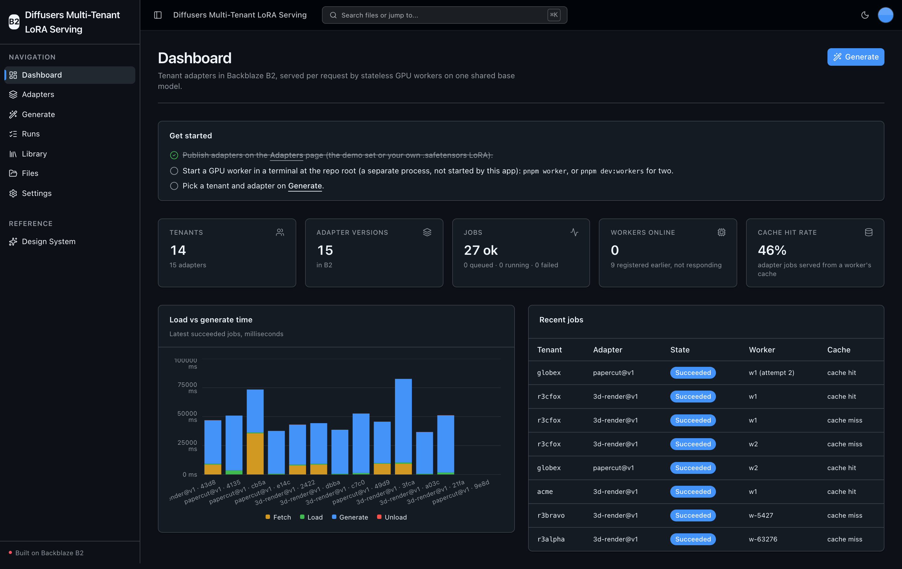
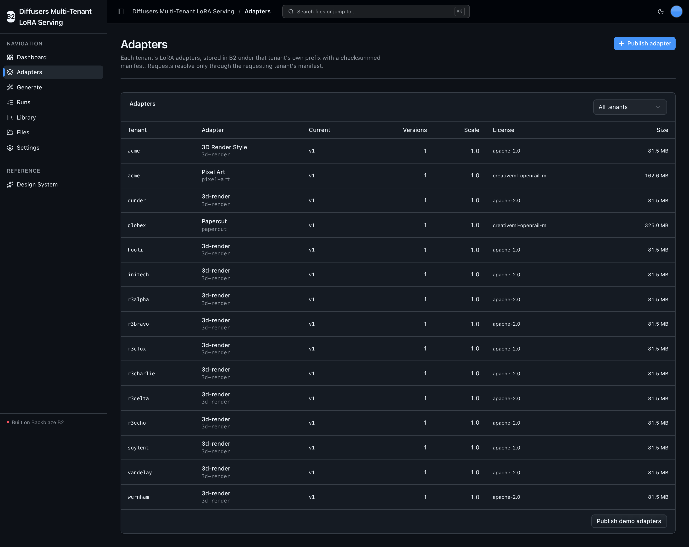
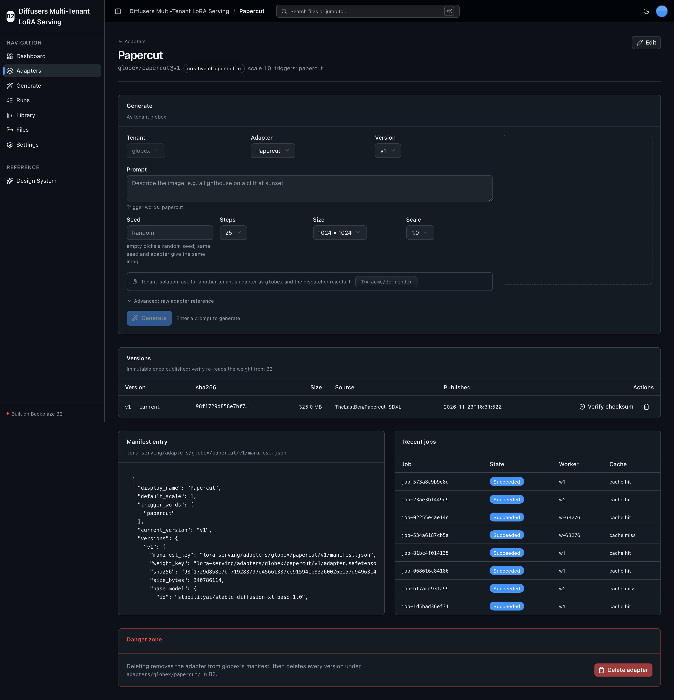
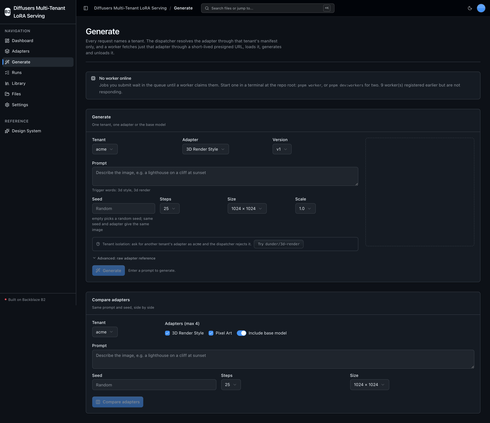
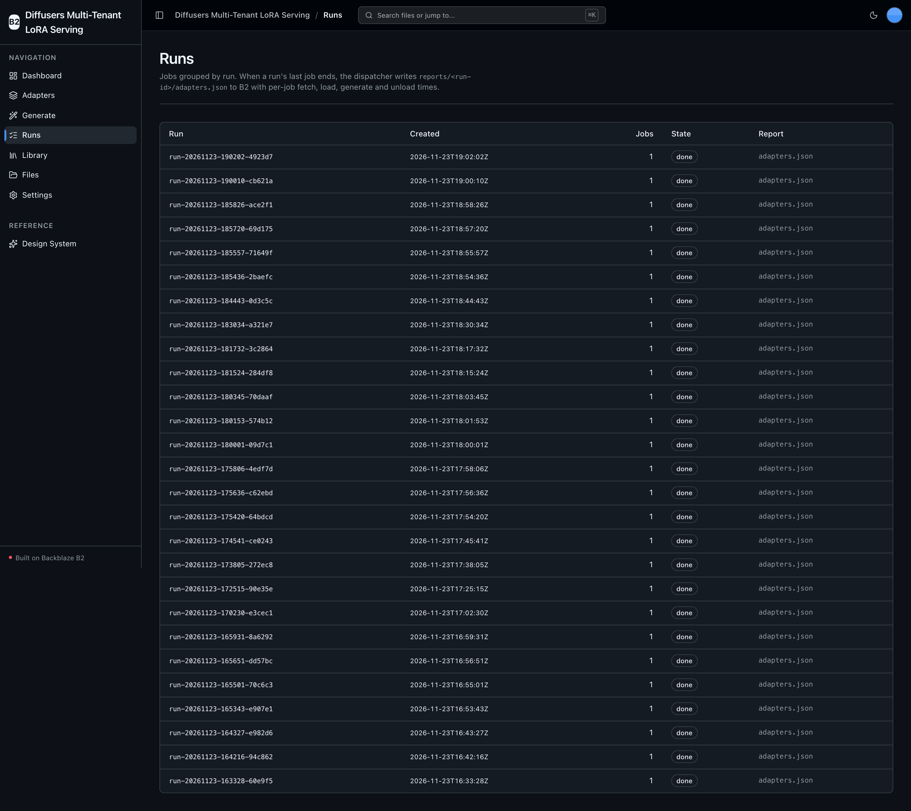
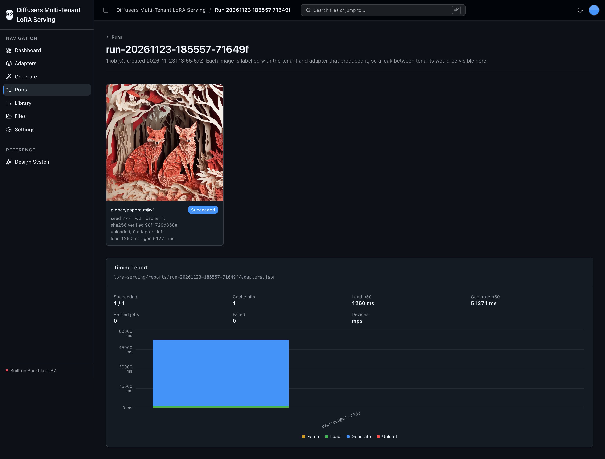
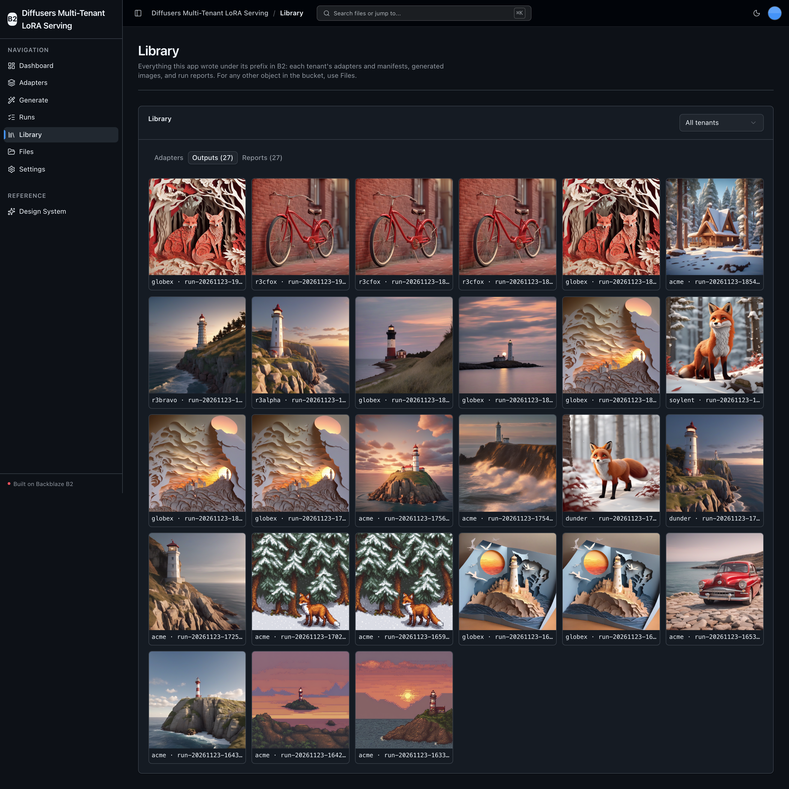

<!-- last_verified: 2026-11-23 -->
<!-- gen:begin readme-header -->
# Diffusers Multi-Tenant LoRA Serving

One base model, every tenant's LoRA adapters in B2, loaded per request. Serve many tenants' LoRA adapters from Backblaze B2 on one shared Diffusers base model, with stateless GPU workers that resolve each request through the tenant's manifest, fetch only that adapter through a short-lived presigned URL and a verified cache, and load and unload it per request.

Built for developers and AI coding agents: the scaffolding, the storage
wiring and the agent-facing docs are already done, so you start on your
app's own features instead of rebuilding the same shell. Storage is
**[Backblaze B2](https://www.backblaze.com/sign-up/ai-cloud-storage?utm_source=github&utm_medium=referral&utm_campaign=ai_artifacts&utm_content=b2ai-diffusers-lora-weights-hub)**, integrated through the S3-compatible API.

**What you get out of the box:**
- Full-stack dashboard UI (Next.js 16, React 19, Tailwind v4, shadcn/ui, TanStack Query, Recharts)
- Adapter Registry: publish, version, edit, verify and delete tenant LoRA adapters
- Adapter Serving: tenant-scoped resolution, presigned fetch, verified cache, load and unload per request
- Generate and Compare: generate per tenant and adapter, compare adapters on one seed
- Runs and Reports: jobs, worker recovery and adapters.json timing reports
- Library: adapters, outputs and reports under the app prefix
- Bucket Explorer: browse, preview, download and delete any object in the bucket
- Dashboard: tenants, adapters, workers, cache hits and timings
- Settings: theme, generate defaults and read-only server config
- Backend with a strict layered architecture and structural tests (FastAPI, Python 3.12+, boto3, Pydantic v2, huggingface_hub, SQLite; workers: PyTorch, Diffusers, PEFT, httpx)
- Agent-optimized docs: your AI coding agent can read the repo and start contributing immediately
<!-- gen:end readme-header -->

<!-- gen:begin readme-screenshots -->
## What it looks like

**Dashboard**: tenants, adapter versions in B2, jobs, workers online and cache hit rate, a fetch, load, generate and unload time chart, and recent jobs per tenant.



**Adapters**: every tenant's LoRA adapters in B2, with current version, scale, license and size, plus publish actions.



**Adapter detail**: one tenant's adapter with a tenant-scoped generate form, immutable checksummed versions, its B2 manifest entry and recent jobs.



**Generate**: generate as a tenant through one of its adapters, try the tenant isolation check, or compare adapters on the same prompt and seed.



**Runs**: jobs grouped by run, each with its adapters.json timing report written to B2.



**Run detail**: the generated image labelled with its tenant and adapter, the verified sha256, cache hit, unload result and the run's timing report.



**Library**: everything the app wrote under its B2 prefix, here the generated outputs labelled by tenant and run.


<!-- gen:end readme-screenshots -->

## What this sample shows

A platform that sells custom LoRA styles to many customers cannot keep every
adapter loaded on every GPU, and a worker that loads the wrong customer's
adapter leaks one tenant's model into another tenant's images. This sample
shows the storage pattern that solves both problems:

- **Backblaze B2 holds every tenant's adapters and manifests.** Each tenant has
  its own prefix with a checksummed manifest. Publishing writes the weight, then
  an immutable version manifest, then the tenant manifest last.
- **A dispatcher resolves every request through the requesting tenant's own
  manifest.** Another tenant's adapter is rejected (403 or 404) before any job
  exists or any URL is signed.
- **GPU workers are stateless and hold no storage credentials.** A worker
  receives a presigned URL for exactly one adapter (valid for 5 minutes),
  verifies its sha256 into a tenant-scoped local cache, loads it onto the one
  shared SDXL base model, generates, and unloads it.
- **A killed worker loses nothing.** Jobs carry a lease and a fixed seed; the
  next worker re-renders the same image, and the late result from the dead
  attempt is rejected.

Why B2 matters here: adapters are the multi-tenant state. Keeping them in B2
(instead of on each GPU host) is what lets any worker serve any tenant, lets you
add or replace workers freely, and gives one audited place where a tenant's
adapters live. Workers download only the adapter a request needs, once per
cache.

## Quick Start

You need: Node.js >= 20, pnpm >= 10, Python >= 3.12, a free
**[Backblaze B2 account](https://www.backblaze.com/sign-up/ai-cloud-storage?utm_source=github&utm_medium=referral&utm_campaign=ai_artifacts&utm_content=b2ai-diffusers-lora-weights-hub)**,
and a machine that can run SDXL: an NVIDIA GPU, or Apple silicon with about
32 GB of unified memory for two workers (validated on an M4 Max with 36 GB). CPU
works but takes minutes per image.

**1. Run setup**

```bash
pnpm run setup
```

This copies `.env.example` to `.env` (only if missing), installs workspace
dependencies, and creates two Python 3.12 virtualenvs: `services/api/.venv`
(the dispatcher, from `services/api/requirements.lock`) and
`services/worker/.venv` (PyTorch, Diffusers and PEFT, from
`services/worker/requirements.lock`, about 1 GB of wheels). It is safe to rerun.

> Use the `pnpm run` form: `setup` (like `doctor`) is a built-in pnpm command
> before pnpm 11.

**2. Add your B2 credentials** to `.env`. Head to the
[Backblaze B2 dashboard](https://secure.backblaze.com/b2_buckets.htm?utm_source=github&utm_medium=referral&utm_campaign=ai_artifacts&utm_content=b2ai-diffusers-lora-weights-hub) and:

<!-- gen:begin readme-credentials -->
1. **Create a bucket** and an **application key** with `Read and Write`
   permission, then paste each value into `.env`:
   - `B2_APPLICATION_KEY_ID`: B2 application key ID (**keyID** in the B2 console); dispatcher only
   - `B2_APPLICATION_KEY`: B2 application key (**applicationKey**), shown once at creation; dispatcher only
   - `B2_BUCKET_NAME`: bucket unique name (**Bucket Unique Name** in the B2 console)
   - `B2_REGION`: the region inside the bucket's **Endpoint** (`s3.<region>.backblazeb2.com`); the S3 endpoint is derived from it

   B2 shows an application key once, at creation. The optional variables are
   documented in `.env.example` and in the delivery runbooks.
<!-- gen:end readme-credentials -->

Only the dispatcher reads these. Everything the app writes lands under
`APP_PREFIX` (default `lora-serving/`), so it can share a bucket.

**3. Start the dispatcher and web app**

```bash
pnpm dev
```

Web at `localhost:3000`, API at `localhost:8000` (Swagger UI at `/docs`).

**4. Start two workers** in a second terminal

```bash
pnpm dev:workers
```

Each worker loads the SDXL base model once. The first start downloads it from
the Hugging Face Hub: `stabilityai/stable-diffusion-xl-base-1.0`, fp16 weights,
about 6.5 GB, not gated. Loading takes about 30 s cold and 7 s warm on an
M4 Max. `pnpm worker` starts a single worker instead (`WORKER_ID` defaults to
`w-<pid>`).

**5. Publish the demo adapters and generate**

Open `/adapters` and click **Publish demo adapters** (or run
`pnpm publish:fixtures`). This downloads three pinned public SDXL LoRAs (about
600 MB) and publishes them for two tenants: `acme` (`pixel-art`, `3d-render`)
and `globex` (`papercut`). Then open `/generate`, pick a tenant and adapter, and
generate. Open **Advanced** and type `globex/papercut` while acting as `acme` to
see the isolation check reject it.

`pnpm dev` runs `pnpm run doctor` first; it also warns when the worker venv is
missing or `WORKER_TOKEN` is unset.

## How it works

```
 browser ──► dispatcher (services/api, FastAPI, the only B2 credentials)
               │  adapters/<tenant>/manifest.json  ◄── resolve per request
               │  SQLite job queue with leases
               ▼
     claim ◄── worker w1 / w2 (services/worker, PyTorch + Diffusers)
               │  presigned GET: one adapter ──► verify sha256 ──► tenant cache
               │  load_lora_weights ► generate ► delete_adapters
               └─ presigned PUT: outputs/<tenant>/<run>/<job>.png
```

### Key layout in B2

```
<APP_PREFIX>adapters/<tenant>/manifest.json                         tenant manifest (written last)
<APP_PREFIX>adapters/<tenant>/<adapter>/<version>/adapter.safetensors
<APP_PREFIX>adapters/<tenant>/<adapter>/<version>/manifest.json     version manifest (immutable)
<APP_PREFIX>outputs/<tenant>/<run-id>/<job-id>.png
<APP_PREFIX>reports/<run-id>/adapters.json
```

Tenant and adapter names must match `^[a-z0-9][a-z0-9-]{1,38}[a-z0-9]$` and
versions `v1`, `v1.2` or `v1.2.3`, so no request can build a key outside its
prefix.

### Resolution and isolation

A request is `POST /tenants/{tenant_id}/generations` with an adapter written as
`name`, `name@version`, `owner/name[@version]`, or `null` for the base model.
The dispatcher reads that tenant's manifest (cached 10 s, revalidated by ETag)
and refuses before anything is queued:

| Situation | Answer |
|---|---|
| `owner` is another tenant | 403 `cross_tenant_adapter` |
| name or version not in this tenant's manifest | 404 `adapter_not_found` (never reveals other tenants) |
| manifest entry points outside `adapters/<tenant>/`, or the version manifest names another tenant | 403 `manifest_tenant_mismatch` |
| version manifest targets another base model | 422 `base_model_mismatch` |

Presigned URLs are signed only when a worker claims the job, so a URL exists
only while a worker holds the lease. The worker re-checks that the claim's
tenant owns the weight key, caches files at `<cache>/<tenant>/<sha256>`, and
asserts no adapter is left loaded after each job.

### The publish safety rule

1. Validate: identifiers, license allowlist, a well-formed safetensors header
   (pickle formats such as `.bin`, `.pt` and `.ckpt` are refused).
2. Stream the weight to B2 (managed multipart) while hashing it.
3. `head_object` to confirm the stored size.
4. Write the version manifest.
5. Rewrite the tenant manifest **last**.

A publish that fails before step 5 leaves the tenant manifest unchanged, so a
half-published version can never be resolved. Publishing an existing version
returns 409; versions are immutable, publish `v2` to change weights.

### Reading `adapters.json`

When a run's last job ends, the dispatcher writes
`reports/<run-id>/adapters.json`. Each job lists the adapter and its sha256, the
worker and attempt, `cache` (`hit`, `miss` or `none` for the base model),
`bytes_fetched`, and `fetch_ms`, `load_ms`, `generate_ms`, `unload_ms`,
`total_ms`. The `summary` gives `cache_hits`, `load_ms_p50`, `generate_ms_p50`
and `retried_jobs`. On the validation machine an adapter load takes under a
second while generation takes 12 to 38 s, which is why loading per request is
practical: the adapter swap is a few percent of the job. `/runs/[runId]` charts
the same numbers.

## When to use

Use this sample when you serve image generation for many customers from a pool
of shared GPU workers and each customer brings their own LoRA styles: you want
one base model in memory, adapters fetched on demand, and a hard guarantee that
a request can only load its own tenant's adapter.

## When not to use

It is not a training pipeline, a model-hub cache, a ComfyUI integration, an
autoscaler or a GPU scheduler. It has no authentication: the tenant in a request
is trusted as given, so production puts an authenticating gateway in front that
sets it. One dispatcher owns manifest writes and the SQLite queue; running
several dispatchers needs a shared queue and lock. You own the security,
operations and compliance decisions of anything you adapt.

## Model and adapter licenses

Weights are never committed to this repository; the worker and the publish
script download them from the Hugging Face Hub. Every adapter fixture was
checked with `huggingface_hub.model_info` on 2026-11-23 and pinned by commit in
[`fixtures/adapters.yaml`](fixtures/adapters.yaml). Two other candidates
(`ostris/ikea-instructions-lora-sdxl`, `CiroN2022/toy-face`) were left out
because their cards declare `license: other`.

| Model | Role | Commit | File | sha256 (first 16) | License |
|---|---|---|---|---|---|
| [stabilityai/stable-diffusion-xl-base-1.0](https://huggingface.co/stabilityai/stable-diffusion-xl-base-1.0) | base model | `462165984030` | fp16 variant | - | [CreativeML Open RAIL++-M](https://huggingface.co/stabilityai/stable-diffusion-xl-base-1.0/blob/main/LICENSE.md) |
| [nerijs/pixel-art-xl](https://huggingface.co/nerijs/pixel-art-xl) | `acme/pixel-art` | `8bf4a4d9ea28` | `pixel-art-xl.safetensors` | `4234637cb80c998f` | [CreativeML OpenRAIL-M](https://huggingface.co/spaces/CompVis/stable-diffusion-license) |
| [goofyai/3d_render_style_xl](https://huggingface.co/goofyai/3d_render_style_xl) | `acme/3d-render` | `5ec74a57db5e` | `3d_render_style_xl.safetensors` | `393de3e04d956b13` | [Apache 2.0](https://www.apache.org/licenses/LICENSE-2.0) |
| [TheLastBen/Papercut_SDXL](https://huggingface.co/TheLastBen/Papercut_SDXL) | `globex/papercut` | `b001f28d3913` | `papercut.safetensors` | `98f1729d858e7bf7` | [CreativeML OpenRAIL-M](https://huggingface.co/spaces/CompVis/stable-diffusion-license) |

**Open RAIL use restrictions.** The base model and two of the adapters are
licensed under Open RAIL licenses, which permit commercial use but carry
use-based restrictions (Attachment A of each license). In summary, you may not
use the models or their outputs: to break the law; to exploit or harm minors;
to generate or spread verifiably false information meant to harm others; to
generate personal information that can harm an individual; to defame, disparage
or harass; for fully automated decisions that adversely affect a person's legal
rights; to discriminate against people or groups based on social behaviour or
protected characteristics, or to exploit the vulnerabilities of a group; to
provide medical advice or interpret medical results; or for law enforcement,
justice, immigration or asylum decisions such as predicting criminality. Read
the full text of each license. Anyone who uses this sample's models or the
content they generate must accept these restrictions, and if you redistribute
the models or a service built on them you must pass the same restrictions on to
your users. The registry only accepts adapters whose license is in the
dispatcher's allowlist (`creativeml-openrail-m`, `openrail++`, `apache-2.0`,
`mit`).

## Correctness evidence

**Pre-build spike** (`services/worker/scripts/spike_lora_swap.py`), Apple M4 Max,
36 GB, MPS, fp16, torch 2.15.0, diffusers 0.43.0, peft 0.22.0, 768 px, 12 steps,
seed 42:

| Check | Result |
|---|---|
| Base, then `pixel-art`, then `3d-render`, then base again on one pipeline | mean absolute pixel difference A vs base 0.105, B vs base 0.159, A vs B 0.198 (threshold 0.012) |
| Base after two load/unload cycles vs first base | bit-identical (max pixel difference 0) |
| `get_list_adapters()` after `delete_adapters` | empty after each adapter |
| Adapter load / unload | 980 ms and 781 ms load; 17 ms and 18 ms unload; generate about 10 s |
| fp16 VAE on MPS | no black or NaN images, so the fp16-fix VAE was not needed |
| Two worker-sized SDXL pipelines at once (two processes) | both completed; 14.0 GB device memory each; system free memory never below 30%, so SDXL stays the base model |

**Live self-test** (`pnpm selftest`, run `st-20261123-145142`, 2026-11-23):
real B2 bucket, two workers on one M4 Max, 768 px, 15 steps (40 for the kill
step), all keys under `selftest/<run-id>/`. Passed in 8 min 34 s.

| Step | Result |
|---|---|
| 1. Publish | 3 adapters for 2 tenants in 93 s; every weight re-read from B2 matched its manifest sha256 |
| 2. Isolation | `acme/pixel-art` on `w2` and `globex/papercut` on `w1` at the same time; each job's sha256 belongs to its own tenant; `adapters_after_unload == []` on both |
| 3. Rejections | `acme` asking for `globex/papercut` 403; for `papercut` 404; a tampered `acme` manifest pointing at a globex key 403; zero jobs created |
| 4. Checksums | every adapter completion `sha256_verified: true`; a weight overwritten in B2 failed `checksum_mismatch` and left no cache entry |
| 5. Cache | second `pixel-art` request on `w1`: `cache: hit`, `bytes_fetched: 0` |
| 6. Swaps on one worker | A vs B 0.194, A vs base 0.108, B vs base 0.155 mean absolute difference; A again bit-identical to A |
| 7. Worker kill | `w1` killed with SIGKILL at step 2 of 40; `w2` finished attempt 2 with a bit-identical image (same sha256); the late attempt-1 completion got 409 `stale_attempt` |
| 8. Report | `adapters.json` in B2: 9 jobs, 8 succeeded, 1 failed (the corrupted weight), 3 cache hits, `load_ms_p50` 778, `generate_ms_p50` 13096, `retried_jobs` 1, devices `mps` |
| Cleanup | the 20 keys the run wrote were deleted; nothing left under the run prefix |

Re-run it yourself with `pnpm selftest`; evidence (JSON, the output PNGs and the
process logs) lands in `.local/selftest/<run-id>/`. See
[docs/verification.md](docs/verification.md#live-self-test).

## Core Features

<!-- gen:begin readme-core-features -->
- [Adapter Registry](docs/features/adapter-registry.md): publish, version, edit, verify and delete tenant LoRA adapters
- [Adapter Serving](docs/features/adapter-serving.md): tenant-scoped resolution, presigned fetch, verified cache, load and unload per request
- [Generate and Compare](docs/features/generate.md): generate per tenant and adapter, compare adapters on one seed
- [Runs and Reports](docs/features/runs-and-reports.md): jobs, worker recovery and adapters.json timing reports
- [Library](docs/features/library.md): adapters, outputs and reports under the app prefix
- [Bucket Explorer](docs/features/file-browser.md): browse, preview, download and delete any object in the bucket
- [Dashboard](docs/features/dashboard.md): tenants, adapters, workers, cache hits and timings
- [Settings](docs/features/settings.md): theme, generate defaults and read-only server config
<!-- gen:end readme-core-features -->

Plus the kit's shared pieces: the [Design System](docs/design-system.md) at
`/design`, inline error and empty states, a generated, drift-checked API
contract ([`docs/api/openapi.json`](docs/api/openapi.json)), structural tests,
structured JSON logging, `/health` (B2 reachability, base model, workers online)
and `/metrics` (request counters plus `adapter_rejections_total` by code).

## Tech Stack

- TypeScript, Next.js 16, React 19, Tailwind v4, shadcn/ui, TanStack Query, Recharts
- Dispatcher: Python 3.12+, FastAPI, boto3, Pydantic v2, huggingface_hub, SQLite
- Workers: PyTorch, Diffusers (`StableDiffusionXLPipeline`), PEFT, httpx; CUDA, then Apple MPS, then CPU
- Backblaze B2 through the S3-compatible API
- pnpm workspaces

## Commands

<!-- gen:begin readme-commands -->
| Command | What it does |
| --- | --- |
| `pnpm run setup` | One-time cold start: copy `.env.example` → `.env` (only if missing), install workspace deps, create the backend venv, install locked API deps |
| `pnpm dev` | Start frontend + backend (runs the `pnpm run doctor` preflight first) |
| `pnpm wait-ready` | Block until the running web + API answer, print one line, exit 0/1, use instead of sleeping before driving the app |
| `pnpm contract:export` | Export the FastAPI OpenAPI contract into `docs/api/openapi.json` |
| `pnpm contract:check` | Verify the exported contract and the generated client routes agree, both ways |
| `pnpm gen:api` | Regenerate the shared types, the client route registry and the query-key factory from the exported contract |
| `pnpm gen:docs` | Regenerate the marker-delimited doc regions from `docs/exec-plans/sample.json` |
| `pnpm gen:check` | Fail if any generated file or doc region is stale (first step of `pnpm verify:web`) |
| `pnpm verify` | Credential-free pre-PR suite, runs `check:agent-docs`, `verify:api`, then `verify:web` |
| `pnpm verify:full` | `pnpm verify` plus Playwright E2E; needs a live local stack, real `.env`, a free web port, and Chromium |
| `pnpm test:verify` | Run throwaway verification specs from `apps/web/e2e/verify/` against the app, with the shared browser fixtures |
<!-- gen:end readme-commands -->

This sample adds:

| Command | What it does |
| --- | --- |
| `pnpm worker` | Start one GPU worker (loads the base model, then claims jobs) |
| `pnpm dev:workers` | Start two workers, `w1` and `w2`, with separate adapter caches |
| `pnpm publish:fixtures` | Publish the pinned demo adapters to B2 |
| `pnpm test:worker` | Worker offline tests (CPU, fake pipeline, no network) |
| `pnpm selftest` | The live end-to-end check: real B2, a GPU, two workers |

`pnpm verify` is the gate before a PR: no B2 credentials or GPU needed. It runs
`pnpm check:agent-docs`, `pnpm verify:api` and `pnpm verify:web`. Full reference:
[docs/dev-workflows.md](docs/dev-workflows.md#commands).

## Deployment

<!-- gen:begin readme-deploy-button -->
_This app does not ship a one-click deploy button._
<!-- gen:end readme-deploy-button -->

This sample runs locally: workers need a local GPU, and MPS is not available
inside containers, so there is no serverless target. To run it on GPU hosts,
run one dispatcher and point any number of workers at it with `API_URL` and the
same `WORKER_TOKEN`.

## Related samples

- [hf-cache-sync](https://github.com/backblaze-labs/hf-cache-sync): sync a Hugging Face model-hub cache with B2 (general model caching, which this sample leaves out)
- [comfyui-cloud-storage](https://github.com/backblaze-labs/comfyui-cloud-storage): ComfyUI model folders backed by B2

## Documentation Map

<!-- gen:begin readme-doc-map -->
| Doc | Purpose |
| --- | --- |
| [AGENTS.md](AGENTS.md) | Agent table of contents, start here |
| [ARCHITECTURE.md](ARCHITECTURE.md) | System layout, layering, data flows |
| [docs/features/](docs/features/) | Feature docs (adapter registry, adapter serving, generate and compare, runs and reports, library, bucket explorer, dashboard, settings) |
| [docs/design-system.md](docs/design-system.md) | Design tokens, primitives, loader, error/empty states |
| [docs/app-workflows.md](docs/app-workflows.md) | User journeys |
| [docs/dev-workflows.md](docs/dev-workflows.md) | Engineering workflows, command index, releases |
| [docs/verification.md](docs/verification.md) | What each gate checks, and failure recovery |
| [docs/frontend-conventions.md](docs/frontend-conventions.md) | Frontend conventions, screens, data fetching |
| [docs/SECURITY.md](docs/SECURITY.md) | Security principles |
| [docs/RELIABILITY.md](docs/RELIABILITY.md) | Reliability expectations |
| [docs/api/openapi.json](docs/api/openapi.json) | The checked-in API contract the client seam is generated from |
| [docs/exec-plans/](docs/exec-plans/) | Execution plans, tech debt, and the sample manifest |
<!-- gen:end readme-doc-map -->

## FAQ

**Why load and unload an adapter per request instead of keeping adapters loaded?**
A worker cannot hold every tenant's adapters, and anything left loaded can leak
into the next tenant's image. Loading takes under a second against 12 s or more
of generation, so the safe default is cheap. The worker asserts nothing is left
loaded after every job.

**Why do workers have no B2 credentials?**
A worker runs untrusted prompts on a GPU host; giving it a bucket key would let
it read every tenant's adapters. It only ever receives a presigned GET for the
one adapter its job needs and a presigned PUT for its one output key.

**What happens if a worker dies mid-image?**
Its lease expires (`JOB_LEASE_SECONDS`, default 30 s), the next claim re-queues
the job with the same seed, and another worker renders the same image. The dead
worker's late completion, if it ever arrives, gets 409.

**Can I use SD 1.5 or another base model?**
Set `BASE_MODEL` for both the dispatcher and the workers and publish adapters
for that base; the resolver refuses adapters whose manifest names a different
base model. The worker code loads an SDXL pipeline class, so another family
needs that one line changed.

**Is it free?**
The code is MIT-licensed; the models carry their own licenses (see above).
Backblaze B2 offers a free account to start.

**Does it work on Windows?**
Use WSL2 with an NVIDIA GPU; native Windows is not supported by the scripts.

**Where do I get help?**
Report defects through [GitHub Issues](https://github.com/backblaze-b2-samples/diffusers-multi-tenant-lora-serving/issues).
For B2 account or API help, use [Backblaze Support](https://www.backblaze.com/help).

## Maintenance and support

Backblaze maintains this open-source sample to help developers get started with
B2. Production use is possible with caution and requires your own validation.
It is not covered by the Backblaze service level agreement, and no SLA is
provided for the repository software.

## Contributing

Start with [AGENTS.md](AGENTS.md). For local commit hooks, follow
[the pre-commit workflow](docs/verification.md#pre-commit).

## License

MIT License - see [LICENSE](LICENSE). Model weights are licensed separately; see
[Model and adapter licenses](#model-and-adapter-licenses).
